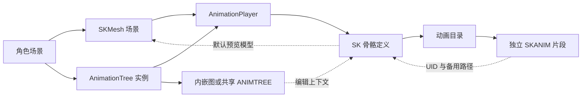

# 骨骼动画资产与中央文档工作区重构

本文用于说明本轮改造的需求、最终设计、实现位置和实际使用流程，可作为 PR 正文的配套说明。功能审查要求、验证缺口及允许调整的设计见[骨骼动画重构审查申请](骨骼动画重构审查申请.md)。

## 代码范围与交付状态

这套功能已经迁入定制引擎。运行时资源和绑定位于 `scene`，导入、预览、剪辑及文档标签位于 `editor`。内置的 `AnimationWorkbenchEditorPlugin` 随编辑器注册，名称中的 Plugin 表示 Godot 编辑器扩展类，无需在项目中安装或启用 `addons`。

2026 年 11 月 12 日核对时，历史范围如下。

| 项目 | 内容 |
| --- | --- |
| 建议 PR 比较基线 | `bfe773a47587b47b90184239250be6545ed165d4` |
| 本轮首个提交 | `641d8a5e653ae477cf59e94d0db83eec37af654a`，动画资源格式与导入保存 |
| 后续已有提交 | `0944a2c46c`，动画库管理入口；`fb98138980`，管理操作即时落盘 |
| 原型阶段的最后提交 | `fb9813898046dac5f429ce078fe979ff7b525c76` |
| 审查分支 | `codex/skeletal-animation-review` |
| 最终实现位置 | 审查分支 HEAD，包含上述历史提交、最终重构源码和配套文档 |

比较应包含首个提交，使用其父提交作为 base。审查材料以该基线到审查分支 HEAD 的完整差异为准，实际 head SHA 以 PR 为准。后续审查修复继续追加到同一分支，审查结论记录当时的 head SHA。

历史提交中的独立 `.animlib`、早期自动拆库等设计已经被后续实现替换。本文说明当前最终设计。准备 PR 时应通读 base 到最终 head 的合并差异。

游戏项目属于另一个仓库。2026 年 11 月 12 日已将其本地 main 回退至旧插件引入前的 `856d4cb1261d44b3adabf14997d565d203ffc32a`，清理旧插件与工具试验资产，恢复游戏原有动画库引用，保留游戏内容的工作区修改。引擎功能不依赖这些项目修改，游戏项目也不作为本 PR 的交付内容。此前的三维本地坐标默认值、GDScript 检查工具及上游合并已位于建议基线之前。

## 需求与使用目标

主要使用场景是 3D 角色骨骼动画。用户希望导入模型后即可查看模型关联的动画，后续导入同骨骼动画时，各模型自动获得动画；双击骨骼或片段即可预览；常用片段修改能够直接保存到当前资产。

日常编辑以搜索、快速切换、播放暂停、拖动时间轴和删除时间区间为主。逐关节制作动画、复杂曲线编辑及跨骨骼重定向暂未纳入轻量工具。动画图负责动画组合，片段工作区负责观察和剪辑，两者使用独立的中央文档。

开发资产采用文本序列化，方便 Git 比较和 AI 读取。骨骼、模型、片段和动画图各自有清楚的职责，主要操作通过显式入口完成。新项目直接使用定制引擎即可获得功能。

## 资产模型与职责

| 文件或对象 | 底层类型 | 拥有的内容与职责 |
| --- | --- | --- |
| `.sk` | `SkeletonDefinition` | 骨名、父子关系、局部 Rest、动画目录路径、默认预览模型的软引用 |
| `.skanim` | `Animation` | 单个片段的轨道、关键帧、时长、循环设置、采样率元数据及骨骼软关联 |
| `.skmesh` | `PackedScene` | 可实例化的模型场景，包含 Skeleton3D、网格、Skin 和 AnimationPlayer |
| 可选 `.animtree` | `AnimationRootNode` | 可复用的动画图结构，以及用于编辑上下文的骨骼软关联 |
| `AnimationPlayer` 节点 | 原生播放器 | 绑定 `.sk`，取得共享动画目录，为 AnimationTree 提供动画；保留原生播放 API |
| `AnimationTree` 节点 | 原生动画树 | 由角色场景配置，引用模型的 AnimationPlayer，使用内嵌或共享图并维护角色实例的运行状态 |

`.sk` 记录动画目录，每个片段保存在独立的 `.skanim` 中。引擎用原生 `AnimationLibrary` 提供目录中的动画，关联同一骨骼的 SKMesh 共用这份动画集合。

骨骼资产与动画的关系需要区分“兼容”和“归属”。骨名、层级和 Rest 一致用于导入兼容性校验；资产之间通过明确选中的同一份 `.sk` 建立归属。两份结构相同但各自创建的骨骼资产具有各自的目录。



虚线表示按需解析的软关联。片段和骨骼之间使用软关联避免目录与片段互相强引用加载；预览模型在打开预览时才加载。运行时模型通过 AnimationPlayer 引用骨骼，再取得目录及片段。

### 文本存储

`.sk`、`.skanim` 和 `.animtree` 使用 Godot 文本资源序列化，`.skmesh` 使用文本场景序列化。Mesh、Skin 等模型数据内嵌在 SKMesh 场景里，模型导入默认不另外生成网格 `.res`。

文本序列化使结构和引用可读。网格的顶点、索引等数据可能包含较大的编码数组，几何和权重调整仍通过建模工具及模型更新入口完成。AI 可以直接读取、修改骨骼与动画结构，修改后需要使用资源加载和语义校验确认结果。

新增扩展名的读取、保存、类型检查、UID 及依赖处理接入原生资源格式实现。通用 `.tres`、`.res` 和普通场景资源仍属于引擎支持范围；具体兼容边界需按审查申请执行回归。

### SKMesh 的节点约定

```text
模型根节点
├─ Skeleton3D
├─ Meshes
│  └─ 各 MeshInstance3D
└─ AnimationPlayer
```

AnimationPlayer 的 Root Node 指向模型根节点。角色场景中的 AnimationTree 通过 Anim Player 指向模型内部的 AnimationPlayer，并沿用其 Root Node。骨骼轨道统一使用 `Skeleton3D:骨名`，网格相关轨道使用 `Meshes/网格名:属性`。标准路径使同骨骼片段可以在不同 SKMesh 的固定结构中解析。

模型仍通过 Skeleton3D、Skin、MeshInstance3D 和原生动画运行时完成蒙皮与播放。新增资产结构负责组织、绑定及编辑流程。

## 导入与模型更新

### 导入入口

常用入口是从操作系统拖拽外部 GLB 到编辑器文件系统中的目标目录。编辑器接收源路径和目标目录后打开导入窗口。项目工具菜单也提供导入入口。

窗口中可以分别勾选模型和动画，骨骼选择为同一行的“创建新骨骼”与“使用已有骨骼”。选择已有骨骼时提供项目内骨骼资产的搜索列表。仅导入动画时需要选择已有骨骼。导入采样 FPS 直接显示在窗口底部，仅模型模式下禁用该项。

源 GLB 保留在项目外。目标目录直接平铺生成资产，单骨骼模型使用输入文件名，片段结合源文件名和动画名命名。同名资产使用 `_2`、`_3` 等编号，不加入哈希目录。

### 模型和动画的生成

模型导入可以创建 `.sk` 与 `.skmesh`，或者让新 SKMesh 关联已有 `.sk`。同时导入的动画以 `.skanim` 写入该骨骼的动画目录。

骨骼默认自动匹配：导入器把文件里的骨架与项目内的 `.sk` 逐个比较，优先选完全一致的，其次选可用的；模型一个都匹配不上时新建骨骼。也可以在窗口里指定已有骨骼或强制新建。比较按骨名进行，不要求索引顺序一致。“可用”的定义是共有骨骼的父子关系一致，且共有骨骼不少于较小骨架的一半；Rest 差异、多余或缺失的骨骼只作为警告返回，因为骨骼轨道存的是绝对局部变换。不满足时导入失败，窗口里直接列出不匹配的骨骼。暂未实现重定向。

骨骼按目录生成默认库和命名库。已加载的 AnimationPlayer 通过信号获得库变化，后续实例化的模型从骨骼取得这些库。播放器保存时省略派生库，避免在各个模型场景重复存储。

没有骨骼的输入在此入口下生成普通文本场景，并保留普通模型层级。普通项目内 GLB 的原生导入链仍存在，需与外部 GLB 转资产入口分别理解。

### 从文件更新指定 SKMesh

文件系统右键 `.skmesh` 可以执行“从文件更新 SKMesh”。用户当次选择外部文件，更新使用目标已保存模型中的骨骼进行校验，并替换 Meshes 子树中的模型内容。

目标是保留骨骼身份、AnimationPlayer、共享目录及 AnimationTree 配置。更新操作忽略输入动画。修改了模型场景中的手工配置时，应先保存场景，更新服务以已保存场景为基础工作。

本流程提供导入新资产和更新指定模型两个动作。没有维护外部源文件的长期身份、自动重新导入或动画编辑合并协议。动画再次导入生成新片段，原片段的手工剪辑继续保留。骨骼定义不随模型更新自动改变。

## 中央动画片段工作区

双击 `.sk` 打开骨骼文档，列出其共享目录中的动画；双击 `.skanim` 打开片段文档并选中该片段。场景树中的 AnimationPlayer 双击后打开节点文档，预览其实际引用的动画。选中其他场景节点时，中央文档继续存在。

工作区内部同时包含模型预览、搜索与片段列表、播放控制和剪辑时间轴。右侧检查器保留原生节点与资源属性职责。

### 播放与时间轴

列表默认选择一条普通动画，搜索支持关键字及清空筛选。播放控制使用播放／暂停图标、倍速和默认开启的循环按钮。关闭循环时，播放到末尾停止。空格用于切换播放和暂停，需要避开文字输入等有明确键盘用途的控件。

时间轴支持帧／秒刻度、拖动播放头、滚轮缩放及中键平移。时间显示集中列出当前／总秒数，以及能够确定的当前／总帧数。“重置 Pose”恢复预览模型姿态，“重置时间轴”恢复完整片段的可见范围。

Godot Animation 的基础时间单位是秒。新导入片段记录本次导入采样 FPS，工作区用该值计算帧号和吸附；缺少元数据时参考 Animation.step，无法确定时使用秒。这里的帧率表示导入后的采样率，可能与源文件关键帧的非均匀时间分布不同。源动画的关键帧数量、采样帧数和编辑器运行 FPS 需要分别理解。

### 片段编辑与保存

剪辑区默认展开，初始没有选区。时间条拖动或输入起止位置建立区间，删除包含起点、不包含终点。可以连续删除多段，后续位置以当前剪辑结果为准。当前支持未压缩的 3D 变换与 Blend Shape 轨道，其他启用的轨道类型会阻止剪辑并提示。

删除先产生内存草稿。草稿保存源资源引用、编辑状态序列、当前位置和保存检查点，支持撤销和重做。保存采用“保存当前片段”或 Ctrl+S，正常资产流程直接写回原 `.skanim`，保持资源对象及 AnimationPlayer 引用。保存后撤销只改变当前草稿，再次保存才改变磁盘。

“另存新片段”生成独立 `.skanim` 并登记到当前骨骼目录。它用于主动创建新资产，常用覆盖保存由“保存当前片段”完成。草稿按片段保留，切换片段或标签不会询问，未保存的片段在列表里以星号标出；只有关闭文档时才提供保存、放弃和取消。保存场景不会顺带提交片段草稿，“全部保存”会。保存失败保留草稿及可重试状态。

预览使用独立模型副本和采样播放器，只启用可解析的姿态轨道。采样流程不执行方法、音频等动画轨道。模型副本与场景中实际节点的状态隔离，是预览和退出清理的核心约束。

## AnimationTree 的内嵌与共享

角色场景需要动画混合或状态机时，可在角色根节点下添加 AnimationTree，并把 Anim Player 指向模型实例中的 AnimationPlayer。Tree Root 可以使用角色场景内嵌的图，也可以引用共享 `.animtree`。

双击 AnimationTree 节点打开中央图标签，复用原生 BlendTree、状态机、混合空间和过滤等编辑控件。AnimationTree 的存储有两个清楚的操作模式。

| 模式 | 内容保存位置 | 使用方式 |
| --- | --- | --- |
| 场景内嵌 | 所属 `.skmesh` 或场景 | 当前模型独立维护图，图内容使用场景撤销历史与场景保存 |
| 共享图 | 独立 `.animtree` | 多个 AnimationTree 引用同一图结构，图内容使用独立工作副本及文档保存 |

“选择共享动画图”绑定已有文件，“保存为共享动画图”创建文件并自动绑定，“转为内嵌副本”创建当前节点自己的图。这些操作是普通的场景修改，记录撤销历史，随场景保存落盘，不会顺带保存场景里的其他改动。图内容的修改由对应场景或独立文档保存。

共享的是图结构。各 AnimationTree 的参数、状态机播放状态及运行进度由各实例维护。共享图记录骨骼上下文，绑定时检查骨骼身份，直接打开文件时可以恢复动画资源上下文。

### 节点检查器与图检查器

单击场景中的 AnimationTree 或 AnimationPlayer 显示对应节点检查器；双击进入中央文档和重新激活节点文档也默认显示实际节点。这样 Active、Root Motion、Anim Player 等设置有稳定入口。

动画树文档提供“节点属性”和“图属性”，用于明确选择检查对象。选择图内子节点时沿用原生子节点属性编辑。直接打开独立 `.animtree` 文件时默认检查当前图资源。共享图从节点打开时，文档保存最近的节点上下文，切回标签后可以继续检查该节点。

## 通用文档标签及生命周期

场景、骨骼、动画、动画树和脚本工作区位于同一排中央标签。重复打开激活已有文档。标签可固定，固定区排列在前；固定区与普通区内部支持拖动排序，顺序与固定状态随布局保存并在正常重启后恢复。

脚本先使用唯一的中央工作区标签，多个脚本在原生脚本编辑器内部切换。关闭脚本工作区保留内部文件、光标和未保存内容，再次打开复用原容器。当前顶层 Script 主屏入口已迁移到这个标签。

场景节点文档随所属场景存在，关闭其图标签保留场景拥有的编辑；关闭所属场景或删除节点时，关联文档需要清理。独立资源文档关闭前处理自身草稿，后台文档关闭也需要检查未保存内容。

`EditorSceneTabs` 管理文档标识、排列及激活／保存／关闭／导航回调，`Node3DEditor` 提供中央视图宿主，具体编辑器负责自己的文档内容和草稿。原生动画图控件暂时停放于隐藏容器，关闭或切换时停止处理并隐藏，避免路径栏、错误提示残留到其他视图。释放图工作副本前需要先解除检查器对它的使用。

## 代码导航

| 位置 | 主要职责 |
| --- | --- |
| `scene/resources/skeleton_definition.*` | 骨骼数据、比较、预览软引用、共享目录及保存约束 |
| `scene/resources/animation.*` | 片段的骨骼软关联和采样相关信息 |
| `scene/resources/resource_format_text.cpp`、`core/io/resource_format_binary.cpp` | 扩展名、文本序列化、类型和依赖处理 |
| `scene/animation/animation_player.*`、`animation_mixer.*` | 骨骼目录同步、派生默认库的序列化规则 |
| `editor/import/3d/resource_importer_scene.*` | 外部输入解析后的骨骼校验、资产生成、轨道标准化和模型更新 |
| `editor/editor_interface.*` | 可脚本调用的导入／更新及编辑器文档入口 |
| `editor/animation/animation_workbench_editor_plugin.*` | 片段工作区、预览、时间轴、草稿、保存及导入窗口 |
| `editor/animation/animation_tree_editor_plugin.*` | 中央图文档、共享操作、工作副本与检查器上下文 |
| `editor/animation/animation_blend_tree_editor_plugin.cpp`、`animation_state_machine_editor.cpp` | 原生图编辑控件接入及校验状态处理 |
| `editor/scene/editor_scene_tabs.*` | 通用标签、保存关闭协调、固定排序和恢复 |
| `editor/scene/3d/node_3d_editor_*`、`scene/debugger/view_3d_controller.h` | 中央视图宿主、SKMesh 初次聚焦和视图初始状态 |
| `editor/docks/filesystem_dock.*`、`scene_tree_dock.*`、`editor/scene/scene_tree_editor.cpp` | GLB 拖入、SKMesh 右键更新、动画节点激活与重命名 |
| `editor/script/script_editor_plugin.*`、`editor/editor_node.*`、`editor/editor_undo_redo_manager.*` | 脚本标签、编辑器保存路由及独立文档历史 |
| `doc/classes`、`doc/misu`、中文翻译文件 | 脚本接口、资产规范、操作说明和界面文案 |

## 审查后的调整

2026 年 11 月 12 日在 HEAD `32305b0650` 之上按审查结论做了以下调整，本文其余部分已同步。

片段后缀改为 `.skanim`。Godot 原生的二进制 `.anim` 恢复原生读写，只有 `.sk` 和 `.skanim` 会打开中央片段文档。四种自定义后缀在导出时参与文本转二进制。

导入窗口默认自动匹配骨骼，一次拖入多个文件只确认一次，失败的文件留在窗口里并显示原因。带模型的文件默认会生成 SKMesh，只想追加动画时取消勾选“导入模型”。窗口提供“按原生 GLB 复制”，静态模型可以继续走原生导入。挂在骨骼上的刚性部件随模型保留，没有可用轨道的片段会在结果里列出。

没有骨骼的源文件无法识别出 Skeleton3D，这是 glTF 导入器的行为：骨架至少需要一个蒙皮网格。此时导入失败并说明原因。

工作区新增片段循环模式，它是草稿的一部分，随撤销和保存生效；预览循环按钮只影响预览。骨骼的默认预览模型是项目数据，保存在 `.sk` 里并随版本库共享；缺失时自动使用任意一个引用该骨骼的 SKMesh，不写回文件。区间删除处理所有未压缩轨道、禁用轨道和动画标记。

复制出来的 `.sk` 保存时只保留归属于自己的片段，原骨骼的目录不变。清空 AnimationPlayer 的骨骼定义会同时移除派生的默认库。

普通 AnimationPlayer 在 2D、界面和 3D 场景中都使用 Godot 原生动画停靠面板编辑轨道和关键帧。绑定骨骼定义的 3D 播放器仍可打开片段工作区。

中央文档由 3D 主屏承载。从 2D 主屏打开脚本或动画文档后，切回场景标签会回到原来的主屏，2D 场景的编辑不受影响。

新增的界面文案和导入、剪辑的失败原因都提供了简体中文翻译。贴图按“一个模型一份贴图”设计，以带显存压缩的方式内嵌在 SKMesh 中。

尚未完成的部分：功能配置关闭 3D 时脚本和动画文档不可用；脚本编辑器的浮动窗口没有恢复。

## 已有自动化入口

已有接口可以用于脚本调用，MCP 可在具备编辑器脚本执行能力时包装这些接口。功能本身不依赖某个 MCP 服务。

| 接口 | 已有用途 |
| --- | --- |
| `SkeletonDefinition.set_bones()`、`compare()` | 构造定义与获取骨骼差异 |
| `Skeleton3D.create_skeleton_definition()` | 从现有骨骼节点生成定义 |
| `EditorInterface.import_animation_assets(source, destination, settings)` | 导入外部 GLB，返回 error、message 与 metadata |
| `EditorInterface.update_skeletal_mesh(source, target)` | 更新指定 SKMesh |
| `AnimationWorkbenchEditorPlugin.open_resource()`、`open_player()`、`select_animation()` | 打开文档并定位片段 |
| `get_current_animation()`、`delete_range()`、`undo_edit()`、`redo_edit()`、`save_animation()` | 操作片段草稿并保存 |
| `EditorInterface.get_animation_workbench()`、`open_animation_node(node)` | 取得工作区对象，按双击规则打开动画节点文档 |
| `AnimationWorkbenchEditorPlugin.delete_clip_range(animation, first, last)` | 静态的纯数据操作，返回 error、message、animation 和 removed_markers |
| `import_files(sources, destination, settings)` | 批量导入，返回逐文件结果 |
| `set_loop_mode()`、`set_playing()`、`seek()`、`set_selection()`、`get_state()`、`get_last_error()` | 驱动并读回播放、选区、循环模式、修改状态和失败原因 |
| `AnimationTreeEditorPlugin.open_node_document()`、`use_shared_graph()`、`save_shared_graph()`、`make_graph_embedded()` | 打开节点图及切换存储形式 |
| `ResourceLoader`、`ResourceSaver`、`PackedScene` 和原生 Animation API | 文本资产读写、实例化和结果断言 |

导入 settings 当前支持 `animation_only`、`import_animations`、`skeleton`、`create_skeleton` 和 `fps`，返回值包含 error、message、warnings 和 metadata。`source` 为外部绝对路径，`destination` 为 `res://` 目录。片段 `delete_range()` 使用秒作为参数，与时间轴当前显示单位无关。工作区对象由内置编辑器创建，调用方需要在编辑器上下文中取得该对象。

## 从空项目走一遍

1. 使用本次构建的定制编辑器创建空项目，建立资产目录。项目无需复制动画插件。
2. 拖入带骨骼的 GLB，勾选模型，选择创建骨骼。确认目标目录得到文本 `.sk` 和 `.skmesh`，同时勾选动画时出现 `.skanim`。
3. 双击 SKMesh，确认模型聚焦，模型下包含 Skeleton3D、Meshes 和 AnimationPlayer，并检查播放器的骨骼绑定。
4. 拖入同骨骼的另一个模型，选择已有 `.sk`。再仅导入一份动画并选择同一骨骼，确认两个模型都能取得新动画。
5. 双击 `.sk` 或 `.skanim`，搜索、切换片段，播放／暂停和拖动时间轴。检查预览模型及原场景的姿态隔离。
6. 建立选区，连续删除两个区间，执行撤销、重做、Ctrl+S。重载文件，检查时长、关键帧和播放器引用。
7. 在角色场景中实例化 SKMesh，添加 AnimationTree，绑定模型中的 AnimationPlayer。双击动画树添加并连接原生图节点，保存场景。再保存为共享 `.animtree`，让另一个角色引用，检查共享结构与实例参数。
8. 从右键菜单更新一个 SKMesh，确认网格变更，同时骨骼、动画目录及图配置保留。
9. 混合打开场景、骨骼、片段、动画图和脚本，固定并排序，关闭有修改的前后台文档，正常重启验证恢复。

公开可复现用例应使用可随仓库分发的最小 GLB 或生成数据。开发机上的 d4man、Baseman61 仅用作实际素材验证，外部审查不应依赖这些绝对路径。

## 验证记录与边界

本地已有空项目验证覆盖模型／动画导入、骨骼复用、文本资产、搜索、独立预览、连续删除、保存与撤销重做、共享图、模型更新及外部文本修改刷新。通用标签另外验证了脚本唯一工作区、保存关闭、固定和拖动。最近一轮验证覆盖两种动画节点的八种激活组合、节点／图属性切换、共享上下文和关闭清理。

可提交的最小回归集位于 `misc/misu/animation_regression`，用脚本现场生成带骨骼的 GLB，不依赖本机素材。执行 `python misc/misu/animation_regression/run.py --godot <编辑器 console 可执行文件>`，它在全新的空项目里以 `--headless --editor` 运行验收场景，输出源码 HEAD、引擎版本、逐场景结果和 `results.json`。随后以按所选场景导出模式生成 PCK，并启动独立无头进程验证包内的动画库及角色动画树。任一步骤失败时返回非零退出码。这些场景覆盖资源数据和编辑器业务两层；预览渲染结果、真实拖放、焦点和标签拖动仍需前台验证。

其余历史脚本和日志位于被 Git 忽略的 `bin/misu`，包括 `native-animation-final-check`、`document-tabs-final-check`、`animation-node-activation-check`、`animation-inspector-check` 等本地工程。它们提供开发验证记录，尚未整理为可由干净克隆自动执行的完整测试包。最新一轮 Windows 编辑器构建、修改文件的格式检查及 `git diff --check` 已通过；不同轮次记录的验证对象可能不同，最终 PR 仍需绑定最终 head 复测。

当前没有证明 90% 以上测试可以不占用前台，也没有完成跨平台、正式导出模板及完整原生功能回归。动画与脚本编辑采用中央标签是已确认需求，审查重点包括迁移是否彻底、旧逻辑是否清理干净、关联功能是否完整接入，以及未处理的副作用。轻量工作区的可编辑轨道范围属于需要明确的功能边界。

资源和运行时代码需要随定制引擎及相应导出模板构建。新增资源类型在官方未定制运行时中的可用性不作为现有验证结论。
